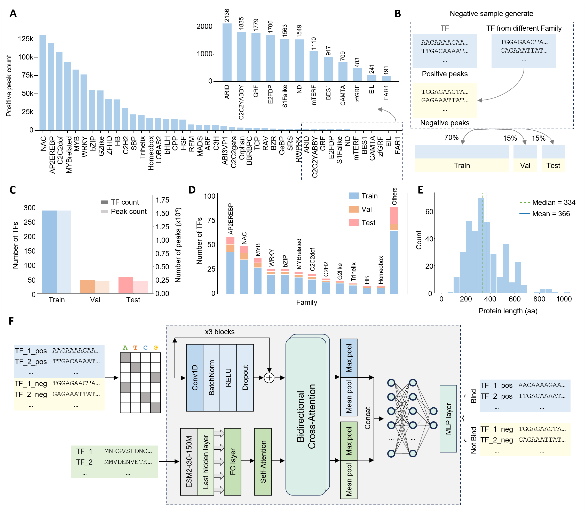
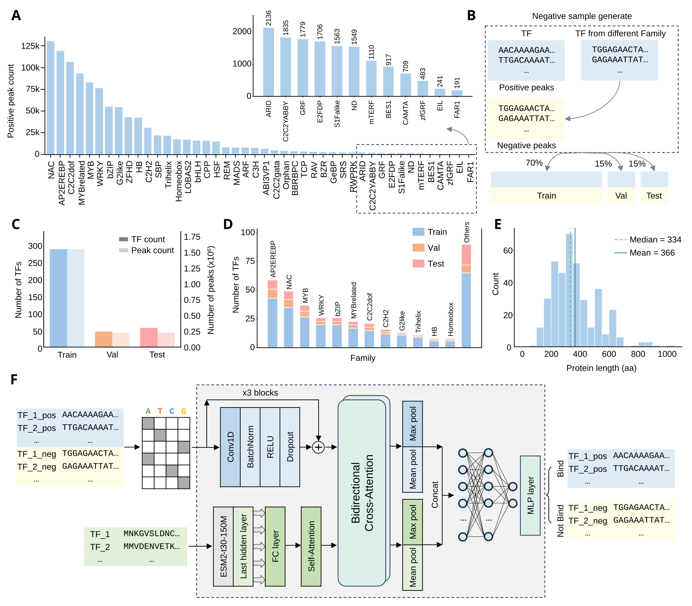

# NexusBind

Predicts whether a transcription factor (TF) binds a DNA sequence, and **where**
— on both molecules.

A DNA sequence and a protein sequence go in; a binding probability plus
per-position importance for every base and every residue come out. The
interpretability is not bolted on: it is read directly off the model's
cross-attention weights.

## How it works





- **DNA branch** — one-hot encoded, three residual Conv1d blocks, no
  self-attention.
- **Protein branch** — frozen `facebook/esm2_t30_150M_UR50D` embeddings, one
  self-attention layer.
- **Cross-attention** — two layers of *bidirectional* attention. The protein
  attends to the DNA and the DNA attends to the protein.
- **~2.5M trainable parameters.** Nothing pretrained is fine-tuned.

The last cross-attention layer is the interpretability surface:

| output | computed as | meaning |
|---|---|---|
| DNA importance | Protein→DNA attention, summed over protein positions | which bases the whole protein is looking at — the binding site |
| Protein importance | DNA→Protein attention, summed over DNA positions | which residues the DNA is looking at — the DNA-binding domain |

`<cls>`/`<eos>` tokens are stripped before reporting, so both importance
vectors are indexed directly by base / residue. Each profile is then min-max
scaled onto [0, 1].

**Every position and index this tool reports is 1-based** — the first base or
residue is position 1, and `scan_promoter.py`'s `end` column is inclusive.
Both tools record `"coordinate_base": 1` in their `result.json` so downstream
code can assert on it rather than assume.

## Install

```bash
python -m venv .venv && source .venv/bin/activate
pip install -r requirements.txt
```

CPU, CUDA and Apple Metal (MPS) are all supported and selected automatically.

## ⚠️ Required: set up ESM2 first

**Nothing in this repository runs without the ESM2 weights.** The protein
branch embeds your sequence with ESM2 at inference time, and the checkpoint
does not bundle it.

CrossBind uses [`facebook/esm2_t30_150M_UR50D`](https://huggingface.co/facebook/esm2_t30_150M_UR50D)
(640-dimensional, ~600 MB). The embedding dimension must be 640 — a different
ESM2 size is rejected with an explicit error.

### Online (simplest)

Do nothing. On the first run `transformers` downloads the weights into
`--esm2-cache-dir` (default `pretrained_models/esm2`).

### Offline / pre-download

```bash
pip install "huggingface_hub[cli]"
hf download facebook/esm2_t30_150M_UR50D --cache-dir pretrained_models/esm2
```

Then pass `--local-files-only` on every invocation so nothing touches the
network.

> **Use `--cache-dir`, not `--local-dir`.** `--esm2-cache-dir` expects the
> HuggingFace *hub* layout (`models--facebook--esm2_t30_150M_UR50D/`), which
> `--local-dir` does not produce. Alternatively set `export HF_HUB_OFFLINE=1`.

On older clients the command is `huggingface-cli download <repo> --cache-dir <dir>`.

## Checkpoint

```
checkpoints/crossbind_at_esm2_t30/best_model.pt     ~10 MB
```

Test-set performance, from a held-out evaluation on 230,782 balanced samples
covering 56 TFs (equal positives and negatives):

| accuracy | AUC | AUPRC | MCC |
|---|---|---|---|
| 0.9154 | 0.9733 | 0.9753 | 0.8318 |

The checkpoint's own validation split scores acc 0.8842 / AUC 0.9676. See
[`checkpoints/CHECKPOINT.md`](checkpoints/CHECKPOINT.md) for full provenance,
hyper-parameters and how the architecture is recovered from the file.

## Quickstart 1 — scan a promoter

The shipped example is the 556 bp *DXS2* promoter scanned with the *MNA1*
protein. Every 200 bp window is scored at stride 1:

```bash
python scripts/scan_promoter.py \
    --checkpoint checkpoints/crossbind_at_esm2_t30/best_model.pt \
    --protein-seq "$(grep -v '>' examples/protein/mna1-protein-seq.faa | tr -d '\n')" \
    --promoter-file examples/promoter/dxs2-promoter.fa \
    --output-dir results/scan_promoter --run-name dxs2_mna1
```

Add `--local-files-only` to the commands above to run fully offline once ESM2
is cached. 556 bp → **357 windows**, peaking at **0.993** in window 12
(bases 12–211) against a mean of 0.014 across the promoter — the top-scoring
window is the predicted binding site.

**This run's output is already committed** at
[`examples/promoter/scan_dxs2_mna1/`](examples/promoter/scan_dxs2_mna1/) if you
want to see what the tool produces before installing anything. See
[`examples/promoter/README.md`](examples/promoter/README.md).

## Quickstart 2 — score one DNA/protein pair

For a single pair, `inference.py` returns the score plus the full attention
matrices for that one 200 bp window:

```bash
python scripts/inference.py \
    --checkpoint checkpoints/crossbind_at_esm2_t30/best_model.pt \
    --protein-seq "$(grep -v '>' examples/protein/mna1-protein-seq.faa | tr -d '\n')" \
    --dna "$(grep -v '>' examples/promoter/dxs2-promoter.fa | tr -d '\n')" \
    --run-name mna1_example
```

Prints the binding score, the top 10 DNA positions and top 10 protein
positions. Note the 556 bp promoter is truncated to 200 bp here — use
Quickstart 1 to scan it in full, then Quickstart 2 on the winning window.

That follow-up run is also committed, at
[`examples/promoter/inference_dxs2_mna1/`](examples/promoter/inference_dxs2_mna1/):
it scores the scan's top window (bases 12–211) and reproduces the scan's
0.9932 exactly, adding the protein side the scan does not report — the
DNA-binding domain localizes to residue 139 of MNA1. See
[`examples/protein/README.md`](examples/protein/README.md) for input format.

## CLI reference

### `scripts/inference.py`

| flag | required | default | notes |
|---|---|---|---|
| `--checkpoint` | ✅ | | path to `best_model.pt` |
| `--protein-seq` | ✅ | | raw amino-acid sequence |
| `--dna` | ✅ | | DNA; trained on 200 bp, longer input is truncated with a warning |
| `--dna-max-len` | | `200` | truncation length |
| `--esm2-model` | | `facebook/esm2_t30_150M_UR50D` | must match the checkpoint's 640-d |
| `--esm2-cache-dir` | | `pretrained_models/esm2` | where ESM2 lives |
| `--local-files-only` | | off | never touch the network |
| `--output-dir` | | `results/inference` | |
| `--run-name` | | `custom_protein_manual` | subfolder under `--output-dir` |

### `scripts/scan_promoter.py`

| flag | required | default | notes |
|---|---|---|---|
| `--checkpoint` | ✅ | | |
| `--protein-seq` | ✅ | | |
| `--promoter` *or* `--promoter-file` | ✅ | | exactly one |
| `--run-name` | ✅ | | subfolder under `--output-dir` |
| `--window-size` | | `200` | **must** be 200 |
| `--stride` | | `1` | window step |
| `--batch-size` | | `8` | windows per forward pass |
| `--output-dir` | | `results/scan_promoter` | |
| `--esm2-model`, `--esm2-cache-dir`, `--local-files-only` | | | as above |

## Outputs

### `inference.py` → `<output-dir>/<run-name>/`

| file | contents |
|---|---|
| `result.json` | score, prediction, lengths, and the top-1 DNA and protein hits |
| `dna_importance.txt` | per-base importance, one value per line (line N = position N) |
| `prot_importance.txt` | per-residue importance, one value per line (line N = residue N) |
| `dna_importance.png` | blue curve, diamond marker at every base |
| `prot_importance.png` | green curve, diamond marker at every residue |
| `dna2prot_attn.npy` | full DNA→Protein attention, `(n_bases, n_residues)`, raw weights |
| `prot2dna_attn.npy` | full Protein→DNA attention, `(n_residues, n_bases)`, raw weights |

Both importance profiles are **min-max scaled onto [0, 1]** after the ESM2
`<cls>`/`<eos>` tokens are removed — the reported peak is exactly 1.0. The
`*_attn.npy` matrices keep the raw attention weights.

`result.json` reports the top-1 hit on each side as a position plus the
sequence window around it (peak ±10):

```json
"dna_top1":  {"position": 98,  "sequence": "ACAGAAAAAAAAGTAGTTTAG"},
"prot_top1": {"position": 139, "sequence": "RVVAPAPELATAADPGKTATT"}
```

### `scan_promoter.py` → `<output-dir>/<run-name>/`

| file | shape | contents |
|---|---|---|
| `window_scores.csv` | 357 rows | one row per window: index, start, end, sequence, score, attention peak (all 1-based; `end` inclusive) |
| `window_attention_importance.npy` | `(357, 200)` | per-base DNA importance profile inside each window; each row min-max scaled to [0, 1] |
| `result.json`, `scan_config.json` | | summary and the exact settings used |

Both tools normalize their importance profiles the same way — min-max onto
[0, 1] — so a peak always reads 1.0.

Attention answers *where* along a window the protein is looking, and is meant
to be read within that window. It is not a measure of how strongly a window
binds; for that use `binding_score`. The one exception is `inference.py`'s
`dna2prot_attn.npy` / `prot2dna_attn.npy`, which hold the raw (unscaled)
attention matrices for the single pair being scored.

## Scope

This release contains **inference only** — the training pipeline, motif
discovery, genome-wide scanning tools and web interface from the development
repository are not included. The model expects the 200 bp window and
ESM2-t30 embedding it was trained with; other configurations are not
supported.

## Data and third-party components

- **ESM2** (`facebook/esm2_t30_150M_UR50D`, Meta AI, MIT) is **not**
  redistributed here — see the ESM2 setup section above.
- The training data (Arabidopsis DAP-seq) is not redistributed here.
- `checkpoints/crossbind_at_esm2_t30/best_model.pt` is a derivative of
  embeddings produced by the ESM2 model above.

## Citation

_To be added._
